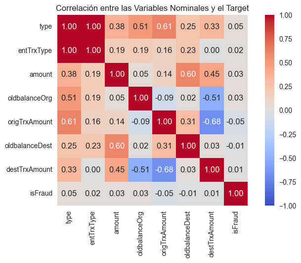
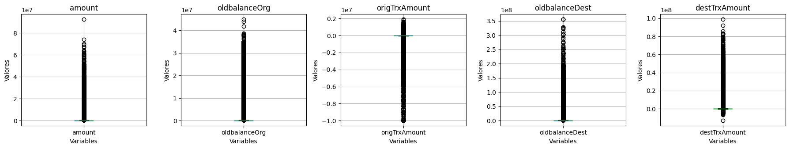

# Detección de fraude en transacciones (PaySim) — CatBoost + Optuna + MLflow + Evidently

Proyecto de ML Engineering (DSRP, `DSRP_MLE3`). Clasificador de fraude sobre el log sintético **PaySim**, con
selección de variables (RFE), optimización de hiperparámetros (Optuna), seguimiento de experimentos (MLflow),
validación fuera de tiempo y monitoreo (Evidently).

📘 Documentación completa: [`docs/documentacion_proyecto.md`](docs/documentacion_proyecto.md)

## a. Problema

Identificar transacciones fraudulentas (`isFraud = 1`) en un escenario de desbalance extremo: 0.08 % de fraude en desarrollo y 0.65 % en producción. Por eso se optimiza **PR-AUC** y **F1**, no la accuracy.

## b. Flujo del proyecto

```
Log crudo ─► 00 Preprocessing ─► 01 Exploración ─► 02 AutoML (PyCaret) ─► 03 RFE + Optuna (CatBoost)
                                                                                    │
         reports/monitoreo ◄─ src/monitoreo_evidently.py ◄─ 04 Implementación (OOT) ◄─┘
```

| Notebook | Qué hace | Salida principal |
|---|---|---|
| `00.Preprocessing` | Variables nuevas, filtro de `isFlaggedFraud`, variable `base` | `train.csv`, `prod.csv`, `processed.parquet` |
| `01.Exploracion` | Particiones, EDA, outliers, asociaciones | `notebooks/eda/*`, `train/test.parquet` |
| `02.AutoML` | Comparación de modelos con PyCaret | CatBoost gana (F1 0.8150, PR-AUC 0.8636) |
| `03.Optimizacion` | RFE y 4 estudios Optuna | `optuna/*.csv`, `models/*.pkl` |
| `04.Implementacion` | Evaluación en producción de 3 modelos | `f1_best_model.pkl` elegido |

## c. Dataset

- PaySim `PS_20174392719_1491204439457_log.csv`: **6,362,620 filas × 11 columnas** (no se versiona).
- Se eliminan 16 filas con `isFlaggedFraud == 1` (todas fraude, filtrarían el target) → 6,362,604 filas.
- Corte temporal por `step`: **Desarrollo** (`step ≤ 400`) y **Producción/OOT** (`step > 400`).

| Base | Filas | Tasa de fraude |
|---|---|---|
| Train | 4,629,620 | 0.0774 % (desarrollo) |
| Test | 1,157,406 | 0.0774 % (desarrollo) |
| Producción (OOT) | 575,578 | **0.6491 %** |

Variables del modelo: `type` (categórica) y numéricas `amount`, `oldbalanceOrg`, `origTrxAmount` (= `newbalanceOrig − oldbalanceOrg`), `oldbalanceDest`, `destTrxAmount` (= `newbalanceDest − oldbalanceDest`, nula para pagos a comercios). Diccionario completo en la [documentación](docs/documentacion_proyecto.md#4-datos).

## d. Resultados por notebook

### 01 · Exploración
`type` y `entTrxType` están perfectamente asociadas (1.00); `type` se relaciona más con el target y se conserva. Ninguna variable supera 95 % de nulos; `destTrxAmount` tiene 33.7 % (pagos a comercios).




### 02 · AutoML (PyCaret, 5 folds, orden por F1)

| Modelo | F1 | PR-AUC |
|---|---|---|
| **CatBoost** | **0.8150** | **0.8636** |
| KNN | 0.7896 | 0.7198 |
| Decision Tree | 0.7806 | 0.6099 |
| XGBoost | 0.6029 | 0.4865 |
| Regresión logística | 0.5403 | 0.5317 |
| Gradient Boosting | 0.2261 | 0.1327 |

CatBoost (Acc 0.9997, AUC 0.9985, Recall 0.7277, Precision 0.9273).

### 03 · RFE y Optuna
**RFE (CatBoost, validación):** con 5 variables F1 = 0.7908, PR-AUC = 0.8356, Recall = 0.7179, Precision = 0.8801, KS = 0.9841, Gini = 0.9952, AUC = 0.9976. Con 4 variables apenas mejora (F1 0.7912) y con 3 cae a F1 0.5776, así que se mantienen 5.

**Optuna (CatBoost, CV estratificado):**

| Estudio | Objetivo | Mejor resultado |
|---|---|---|
| 1 | PR-AUC | 0.8690 (trial 40) |
| 2 | PR-AUC (rangos acotados) | 0.8695 (trial 53) |
| 3 | F1 | interrumpido (≈0.81) |
| 4 | F1 (rangos acotados) | **F1 = 0.8129** (trial 57) |

### 04 · Evaluación en producción (umbral 0.5, predicción binaria)

| Modelo | F1 | Precision | Recall |
|---|---|---|---|
| `prauc_best_model` | 0.5249 | 1.0000 | 0.3558 |
| `f1prauc_best_model` | 0.5793 | 0.9993 | 0.4079 |
| **`f1_best_model`** | **0.6642** | 0.9941 | 0.4987 |

Se elige `f1_best_model`. (Este notebook calcula AUC/PR-AUC con la predicción binaria, por lo que subestima esas métricas; ver el scorecard con probabilidades.)

## e. Scorecard del modelo

**Modelo:** `models/f1_best_model.pkl` — CatBoostClassifier (Estudio 4, trial 57) · **Umbral:** 0.50 · **Versión de datos:** PaySim, corte `step = 400`

| Variable | Rol |
|---|---|
| `type` | categórica |
| `amount`, `oldbalanceOrg`, `origTrxAmount`, `oldbalanceDest`, `destTrxAmount` | numéricas |

Hiperparámetros: `depth=6`, `iterations=801`, `learning_rate=0.1172`, `l2_leaf_reg=18.34`, `random_strength=1.70`, `rsm=0.977`, `scale_pos_weight=1.035`, `subsample=0.587` (Bernoulli), `border_count=128`, `max_ctr_complexity=2`, `one_hot_max_size=2`, `random_seed=666`.

### e.1 Desempeño

| Métrica | CV (5 folds, entrenamiento) | Desarrollo* | Producción (OOT) |
|---|---|---|---|
| Filas | 4,629,620 | 5,787,030 | 575,590 |
| Positivos (fraudes) | – | 4,477 | 3,736 |
| Prevalencia | – | 0.0774 % | 0.6491 % |
| AUC | 0.9984 | 0.9189 | 0.9120 |
| **PR-AUC** | 0.8320 | 0.4979 | **0.5418** |
| Gini | 0.9968 | 0.8378 | 0.8240 |
| KS | 0.9784 | 0.6619 | 0.6376 |
| Precision | 0.9664 | 0.8301 | 0.9941 |
| Recall | 0.7016 | 0.4921 | 0.4971 |
| **F1** | 0.8129 | 0.6179 | **0.6627** |
| Lift vs azar (PR-AUC / prevalencia) | – | 643.6× | 83.5× |
| Alertas (% de transacciones) | – | 0.046 % | 0.325 % |
| Score medio / p95 | – | 0.00274 / 0.01121 | 0.00572 / 0.01238 |

\* Base completa de desarrollo (train + test) puntuada con `src/monitoreo_evidently.py`; incluye datos con los que se entrenó. Fuente: `reports/monitoreo/resumen_modelo.csv`.

> ⚠️ **Hallazgo:** las métricas del monitoreo (Desarrollo PR-AUC 0.498, AUC 0.919) quedan muy por debajo del CV (0.832 / 0.998). Esto sugiere que la ruta de scoring del script no es idéntica a la del entrenamiento (el script mantiene `NaN` en `destTrxAmount` y el notebook usa 0; también difiere el tratamiento de `type`). Hay que unificarla y recalcular antes de dar estas cifras por definitivas. Detalle en la [documentación §11](docs/documentacion_proyecto.md#11-problemas-conocidos-y-deuda-técnica).

### e.2 Estabilidad (PSI Desarrollo vs Producción)

Umbrales: < 0.1 estable · 0.1–0.2 vigilar · > 0.2 inestable.

| Variable | Tipo | PSI | Estado | Media Dev | Media Prod |
|---|---|---|---|---|---|
| `destTrxAmount` | numérica | 0.0088 | estable | 192,711 | 137,256 |
| `origTrxAmount` | numérica | 0.0057 | estable | 21,967 | 13,823 |
| `prediction_proba` (score) | score | 0.0043 | estable | 0.00274 | 0.00572 |
| `oldbalanceOrg` | numérica | 0.0036 | estable | 844,711 | 725,015 |
| `amount` | numérica | 0.0034 | estable | 181,350 | 164,898 |
| `type` | categórica | 0.0031 | estable | – | – (sin categorías nuevas) |
| `oldbalanceDest` | numérica | 0.0025 | estable | 1,092,353 | 1,184,639 |

Nulos de `destTrxAmount`: 33.68 % (Dev) → 35.18 % (Prod).

### e.3 Drift (Evidently)
1 de 9 columnas con drift (`prediction_proba`, distancia de Wasserstein normada 0.126 > 0.1). El resto (`amount` 0.027, `oldbalanceOrg` 0.043, `origTrxAmount` 0.067, `oldbalanceDest` 0.039, `destTrxAmount` 0.055, `type` JS 0.020) está bajo el umbral. Prevalencia: 0.65 % en producción vs 0.08 % en desarrollo. Reportes: `reports/monitoreo/reporte_calidad_drift.html` y `reporte_desempeno.html`.

### e.4 Lectura y limitaciones
- Las variables de entrada son estables (PSI < 0.01); el cambio está en la **tasa de fraude** (×8.4), no en la población.
- Precision ≈ 0.99 y Recall ≈ 0.50 en producción: el modelo casi no genera falsos positivos pero deja pasar la mitad del fraude. Revisar el umbral (con `scale_pos_weight ≈ 1`, las probabilidades no están sesgadas hacia la clase positiva) si el negocio prioriza Recall.
- PR-AUC cae de 0.83 (CV) a 0.54 (OOT); ver el hallazgo de la sección e.1 antes de interpretar la caída.
- Dataset sintético: no garantiza el mismo comportamiento en datos reales.

## f. Cómo ejecutar

```bash
uv sync                                   # Python 3.11
uv run python -m ipykernel install --user --name dsrp3
# Colocar el CSV de PaySim en data/raw/ y ejecutar notebooks/00 → 04
python src/monitoreo_evidently.py         # genera reports/monitoreo/*
```

- **MLflow:** `mlflow ui --backend-store-uri sqlite:///mlflow.db`
- **Optuna dashboard:** `optuna-dashboard sqlite:///optuna/estudio_catboost_fraude2.db`

## g. Estructura

```
data/ models/ mlruns/      # ignorados por git (solo .gitkeep)
notebooks/                 # 00–04 + sbp_modelo.py + eda/
optuna/                    # estudios .db y resultados .csv
src/monitoreo_evidently.py
reports/monitoreo/         # PSI, resumen y reportes Evidently
docs/                      # documentación, imágenes
```
